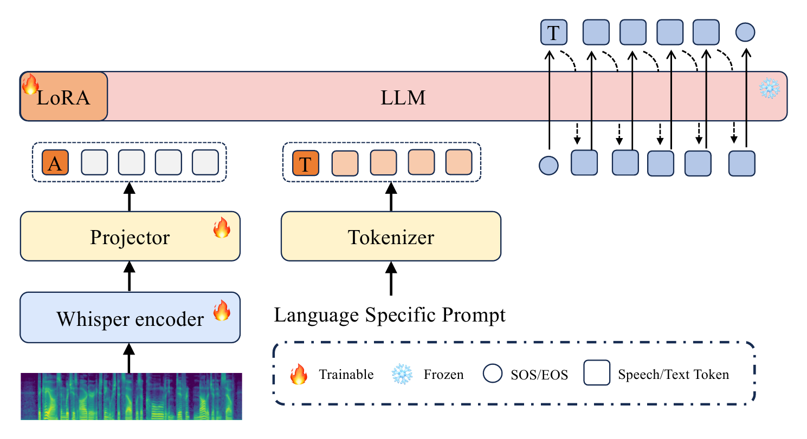
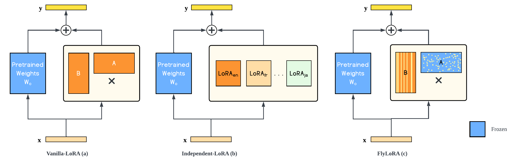
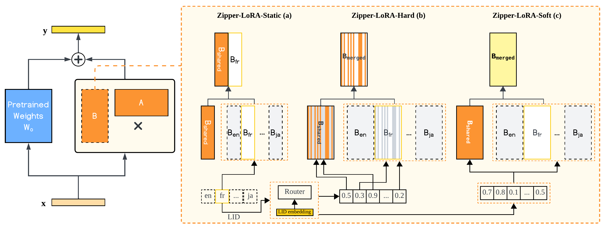
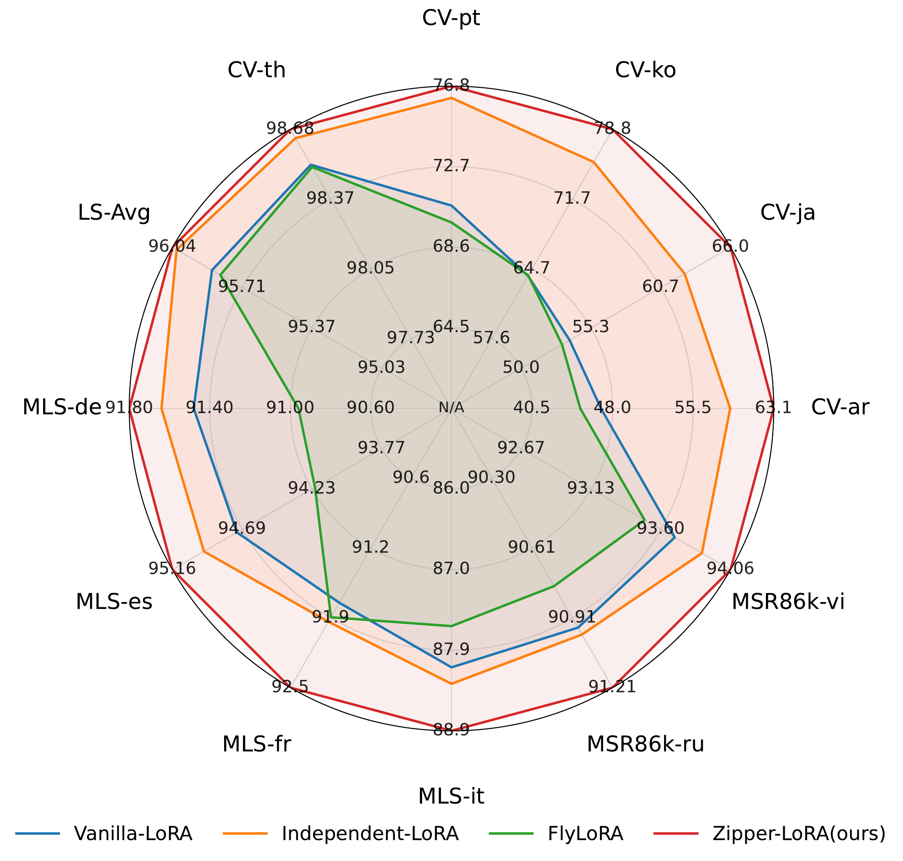
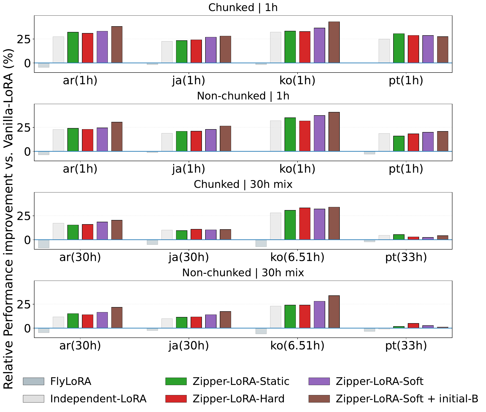
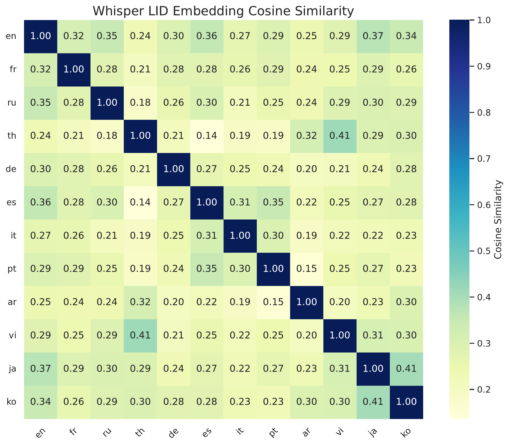
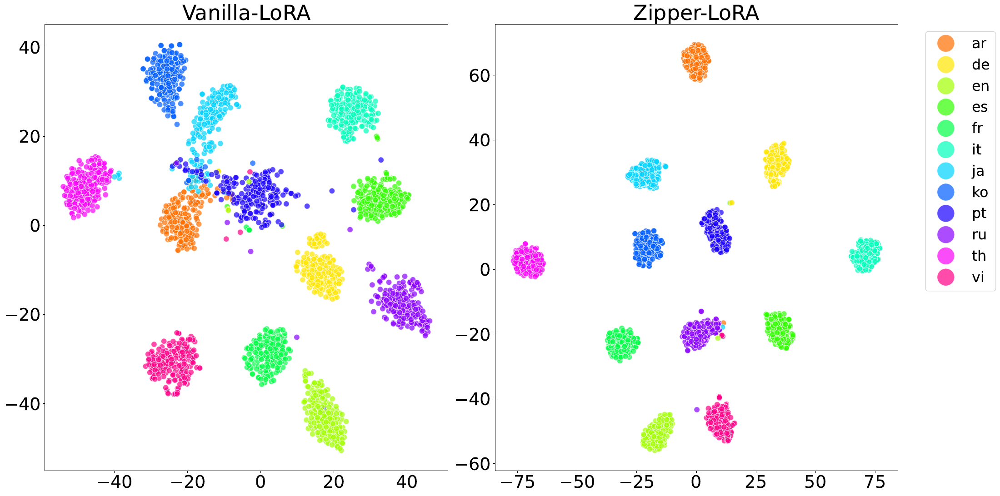

<div align="center">

# Zipper-LoRA

### Dynamic Parameter Decoupling for Speech-LLM Based Multilingual Speech Recognition

**IEEE Transactions on Audio, Speech and Language Processing · 2026**

[](https://ieeexplore.ieee.org/document/11636226)
[](https://huggingface.co/YuCeong-May/Zipper-LoRA/tree/main/ckpts)
[](LICENSE)

[Getting Started](#getting-started) · [Method](#method) · [Results](#results) · [Visualizations](#visualizations) · [Citation](#citation)

</div>

## Overview

Zipper-LoRA is a language-conditioned adaptation framework for multilingual speech recognition. It combines shared and language-specific LoRA parameters at the rank level, balancing cross-lingual knowledge transfer with language specialization under imbalanced supervision.

The framework provides three variants—**Static**, **Hard**, and **Soft**—and an **Initial-B warm start** within a two-stage training strategy. Experiments cover 12 languages with both chunked and full-context speech encoders.

- **Multilingual recognition:** Soft + Initial-B achieves the lowest error rate across all 12 languages in the main non-chunked comparison.
- **Low-resource adaptation:** Up to **40.7% relative error reduction** over Vanilla-LoRA with 1 hour of supervision per language.
- **Parameter efficiency:** Hard and Soft use **38.7% fewer encoder PEFT parameters** than Independent-LoRA.

## Getting Started

```bash
git clone https://github.com/YuCeong-May/Zipper-LoRA.git
cd Zipper-LoRA
python -m pip install -e './inference[inference]'
```

Requires Python 3.10 or later. For NVIDIA GPUs, install a PyTorch build compatible with your CUDA environment before installing the package.

| Resource | Description |
| --- | --- |
| [Usage guide](inference/README.md) | Installation, checkpoint inference, adapter API, and LID embedding export |
| [Model checkpoints](https://huggingface.co/YuCeong-May/Zipper-LoRA/tree/main/ckpts) | Released models on Hugging Face |
| [Data splits](data/utt-id/) | Utterance lists for the experimental training and evaluation subsets |
| [Paper](https://ieeexplore.ieee.org/document/11636226) | Method, experimental setup, and complete results |

## Method

### Speech-LLM Backbone

<p align="center">
  
</p>

The Speech-LLM backbone combines **Whisper Large-v3**, a gated modality projector, and **Qwen3-1.7B**. The encoder and projector reduce the speech sequence by a total factor of 8, producing speech embeddings at 12.5 Hz.

### LoRA Adaptation

<p align="center">
  
</p>

Vanilla-LoRA shares adaptation parameters across languages; Independent-LoRA maintains separate language-specific adapters; FlyLoRA uses sparse rank activation. Adaptation uses rank 32 and LoRA alpha 64.

### Zipper-LoRA Architecture

<p align="center">
  
</p>

Zipper-LoRA composes shared and language-specific updates at the **LoRA rank level**. All three variants share a down-projection matrix A; Static uses a fixed split of the up-projection ranks, Hard selects shared or language-specific columns with a binary router, and Soft continuously mixes the two banks using Whisper language-ID embeddings. **Initial-B** provides a warm start within the two-stage training strategy.

## Results

The evaluation covers **12 target languages**. Eight languages have 500–1,000 hours of supervision each; Arabic, Japanese, Korean, and Portuguese have **1 hour each**. Results below are from the paper.

### Multilingual Speech Recognition

**Non-chunked encoder · WER/CER (%) ↓**

Soft + Initial-B achieves the lowest error rate across all 12 languages among the methods in this comparison (Table V). Japanese, Korean, and Thai use CER; other languages use WER. English is the average of LibriSpeech Clean and Other.

| Dataset | Language | Vanilla-LoRA | FlyLoRA | Independent-LoRA | Zipper-LoRA-Soft + Initial-B |
| --- | --- | ---: | ---: | ---: | ---: |
| Common Voice | Arabic | 53.08 | 55.01 | 41.01 | **36.94** |
| Common Voice | Japanese | 46.28 | 46.86 | 37.53 | **34.04** |
| Common Voice | Korean | 36.03 | 35.99 | 24.53 | **21.35** |
| Common Voice | Portuguese | 29.30 | 30.16 | 23.82 | **23.22** |
| Common Voice | Thai | 1.48 | 1.49 | 1.36 | **1.32** |
| LibriSpeech | English (Avg.) | 4.15 | 4.19 | 3.98 | **3.96** |
| MLS | German | 8.52 | 9.04 | 8.36 | **8.20** |
| MLS | Spanish | 5.27 | 5.79 | 5.05 | **4.84** |
| MLS | French | 8.26 | 8.13 | 8.09 | **7.50** |
| MLS | Italian | 11.86 | 12.36 | 11.66 | **11.09** |
| MSR86k | Russian | 9.05 | 9.23 | 9.02 | **8.79** |
| MSR86k | Vietnamese | 6.31 | 6.51 | 6.13 | **5.94** |

<p align="center">
  
</p>

The radar plot displays 100 minus the WER/CER percentage, so **higher is better**. The original paper figure is reproduced as supplied; use the table above for exact numerical results.

### Low-Resource Adaptation

With 1 hour of supervision per language, the non-chunked Soft + Initial-B model reduces error relative to Vanilla-LoRA by **30.4% on Arabic**, **26.4% on Japanese**, **40.7% on Korean**, and **20.8% on Portuguese**. These relative reductions are calculated from the table above.

| Encoder setting | Method | Arabic WER | Japanese CER | Korean CER | Portuguese WER |
| --- | --- | ---: | ---: | ---: | ---: |
| Chunked | Vanilla-LoRA | 62.32 | 48.93 | 38.37 | 33.49 |
| Chunked | Soft + Initial-B | **38.64** | **35.21** | **21.87** | **24.29** |
| Non-chunked | Vanilla-LoRA | 53.08 | 46.28 | 36.03 | 29.30 |
| Non-chunked | Soft + Initial-B | **36.94** | **34.04** | **21.35** | **23.22** |

Selected results from Table VII. All Zipper-LoRA variants improve over Vanilla-LoRA on these four languages in both encoder settings; chunked Static has the best Portuguese result among the full set of variants (23.26%).

<p align="center">
  
</p>

Bars show relative performance change against Vanilla-LoRA: positive values indicate improvement. The 1-hour condition uses Common Voice for all four languages. In the nominal 30-hour condition, Arabic and Japanese use 30 hours of Common Voice, Korean uses the available 6.51 hours, and Portuguese uses MLS (the original figure labels this subset as 33 hours). Zipper-LoRA retains gains as supervision increases.

### Encoder Efficiency

The paper profiles encoder computation with **30-second audio, batch size 1, bf16, and a forward-backward pass**. Relative speed is normalized to the non-chunked encoder; these are encoder profiling results.

| Encoder setting | Peak GPU memory | Extra peak GPU memory | Extra memory reduction | Relative speed |
| --- | ---: | ---: | ---: | ---: |
| Non-chunked | 6.314 GB | 4.947 GB | — | 1.00× |
| 8-second chunks | 4.382 GB | 3.011 GB | 39.14% | 1.41× |
| 4-second chunks | 4.010 GB | 2.638 GB | 46.68% | 1.53× |
| 2-second chunks | 3.645 GB | 2.273 GB | 54.05% | 1.56× |
| 1-second chunks | 3.580 GB | 2.208 GB | 55.36% | 1.56× |

The experiments use 8-second chunks during decoding. “Extra peak” measures additional GPU memory attributed to encoder computation under the profiling setup.

### Adapter Parameter Footprint

| Method | Encoder PEFT parameters | PEFT / total encoder parameters |
| --- | ---: | ---: |
| Vanilla-LoRA | 23.60 M | 3.16% |
| FlyLoRA | 23.60 M | 3.16% |
| Independent-LoRA | 283.13 M | 28.14% |
| Zipper-LoRA-Static | 88.47 M | 10.90% |
| Zipper-LoRA-Hard | 173.53 M | 19.36% |
| Zipper-LoRA-Soft | 173.53 M | 19.36% |

Hard and Soft use **38.7% fewer encoder PEFT parameters** than Independent-LoRA (173.53 M vs. 283.13 M). These counts cover the encoder side, not the complete Speech-LLM.

## Visualizations

### Language-ID Similarity

<p align="center">
  
</p>

The cosine-similarity heatmap shows the structure of Whisper LID embeddings used as the routing anchor. Japanese/Korean and Thai/Vietnamese each have a cosine similarity of 0.41 in the paper's analysis.

### Encoder Representations

<p align="center">
  
</p>

Each point represents an utterance embedding, colored by language. Compared with Vanilla-LoRA, Zipper-LoRA-Soft yields more compact language clusters for **10 of 12 languages**. The average per-language covariance determinant in the **2-D t-SNE coordinates** decreases from 392.67 to 109.12 (72.21%); Arabic and Italian are the exceptions. This visualization complements the recognition results.

All figures and reported measurements in these sections come from the paper; relative error and parameter reductions are calculated from its reported values.

## Repository Structure

```text
Zipper-LoRA/
├── asserts/             # Architecture and experimental figures
├── data/utt-id/         # Training and evaluation utterance lists
├── inference/
│   ├── src/zipper_lora/ # Adapter modules and checkpoint loader
│   ├── examples/       # ASR example
│   ├── tools/          # Whisper LID embedding export
│   └── tests/          # Adapter injection and checkpoint tests
├── LICENSE
└── README.md
```

## License

The code is released under the [Apache License 2.0](LICENSE). Refer to the respective source datasets and base models for their terms of use.

## Citation

If you find this work useful, please cite our paper:

```bibtex
@article{ZipperLoRA2026,
  author={Mei, Yuxiang and Qiu, Delai and Liu, Shengping and Liang, Jiaen and Long, Yanhua},
  journal={IEEE Transactions on Audio, Speech and Language Processing},
  title={Zipper-LoRA: Dynamic Parameter Decoupling for Speech-LLM Based Multilingual Speech Recognition},
  year={2026},
  volume={34},
  pages={3956--3969},
  doi={10.1109/TASLPRO.2026.3719331}
}
```
